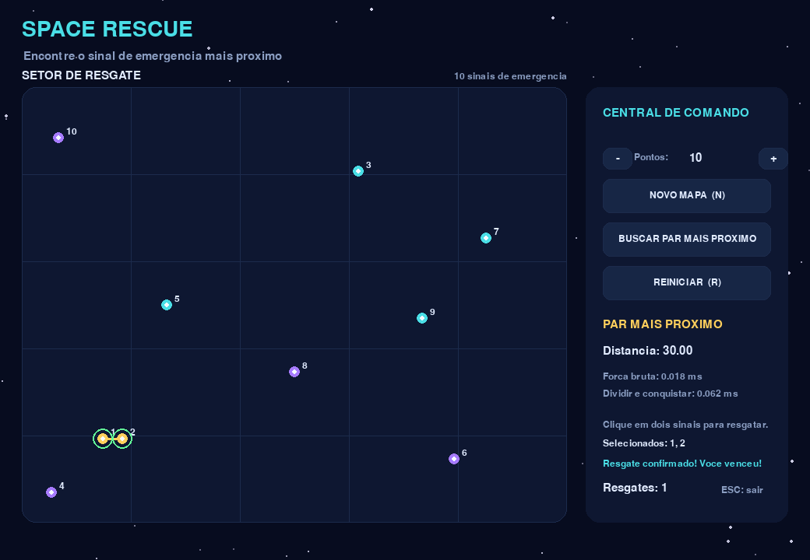

# G41_Dividir-e-Conquistar_PA-26.2

O projeto...

## Vídeo

Link do vídeo [aqui](https://youtu.be).

## Screenshot



## Como o jogo funciona

## Como executar

1. Crie um ambiente virtual (opcional, mas recomendado):
   ```bash
   python -m venv .venv
   .venv\Scripts\activate
   ```
2. Instale as dependências:
   ```bash
   pip install -r requirements.txt
   ```
3. Execute o jogo:
   ```bash
   python game.py
   ```